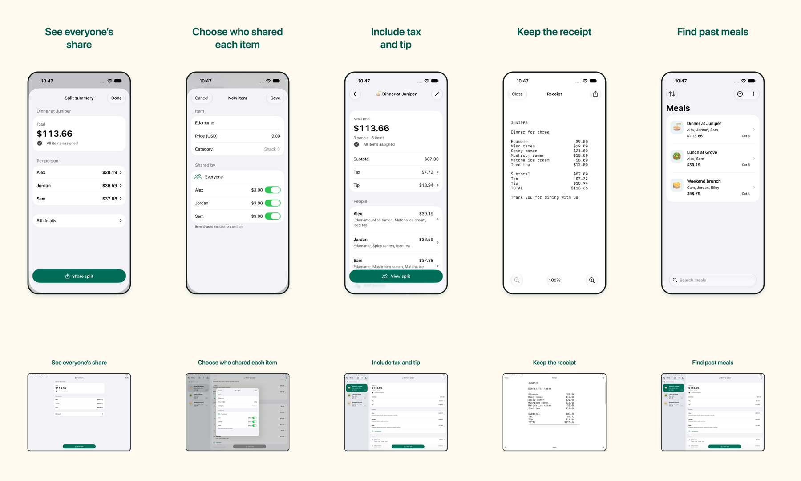

# App Store screenshots

Five ordered posters for each device: iPhone with Dynamic Island, medium display, at 1206 × 2622 and iPad 13-inch at 2752 × 2064. Each uses a complete native simulator screen, a warm neutral canvas, emerald headlines, and a simple presentation frame. The app interface is neither reconstructed nor stretched. Meal names, people, and receipt data are fictional fixtures.



| Order | Headline | iPhone | iPad |
| --- | --- | --- | --- |
| 1 | See everyone’s share | [Poster](iphone/01-share.png) | [Poster](ipad/01-share.png) |
| 2 | Choose who shared each item | [Poster](iphone/02-assign.png) | [Poster](ipad/02-assign.png) |
| 3 | Include tax and tip | [Poster](iphone/03-tax-tip.png) | [Poster](ipad/03-tax-tip.png) |
| 4 | Keep the receipt | [Poster](iphone/04-receipt.png) | [Poster](ipad/04-receipt.png) |
| 5 | Find past meals | [Poster](iphone/05-library.png) | [Poster](ipad/05-library.png) |

Upload the five posters from each device folder in numeric order. The contact sheet and captures are review evidence, not upload assets. All posters are opaque RGB PNGs with an sRGB profile.

Screenshot dimensions were checked against [Apple’s specifications](https://developer.apple.com/help/app-store-connect/reference/app-information/screenshot-specifications) on 13 October 2026. Select the matching device category in App Store Connect’s Media Manager.

## Source and reproduction

[The manifest](manifest.json) binds each poster to its exact capture bytes, headline, dimensions, renderer, and native capture source. Nine captures use the [initial frozen source](source-manifest.json); iPad poster 4 uses the [receipt recapture source](receipt-source-manifest.json), whose only changed input is the UI test’s native zoom-and-pan sequence. All production source hashes match between the two captures. The iPad inputs retain the full landscape interface after orientation normalization. Native capture results and original orientation evidence are recorded separately from composition hashes.

```sh
swift scripts/prepare-app-store-screenshots.swift \
  --iphone docs/app-store-assets/captures/iphone \
  --ipad docs/app-store-assets/captures/ipad \
  --manifest docs/app-store-assets/source-manifest.json \
  --receipt-manifest docs/app-store-assets/receipt-source-manifest.json \
  --output /tmp/split-my-meal-store-posters
```

The renderer records its macOS version and font name because system font rasterization can differ between OS releases. It rejects missing, incorrectly sized, transparent, or orientation-dependent captures before creating output.
