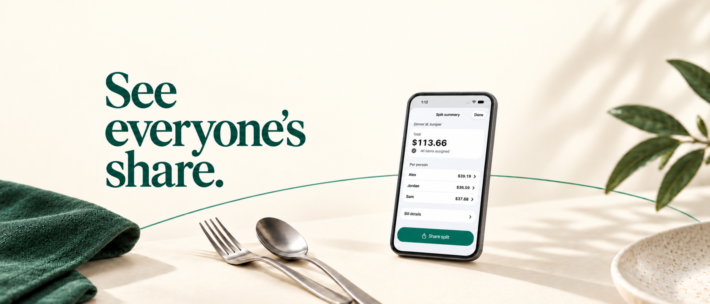
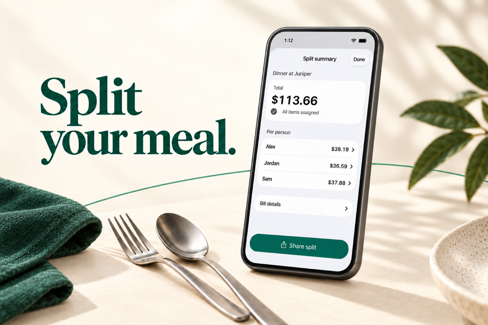

# App Store editorial assets

Two coordinated creative assets use cream, emerald, tactile dining props, serif headlines and a smooth generic device at a modest 3D angle. These are generated editorial depictions based on the real split-summary capture; their perspective typesetting is not pixel-identical to the native screenshot.

| Placement | File | Format | Headline |
| --- | --- | --- | --- |
| Product-page header | [Header](header.png) | 3840 × 1646, opaque sRGB PNG | See everyone’s share. |
| Search results | [Search](search.png) | 1920 × 1280, opaque sRGB PNG | Split your meal. |





Independent visual and copy reviews checked the composition, labels and fictional meal amounts: Alex $39.19, Jordan $36.59 and Sam $37.88 total $113.66. The device frame omits physical buttons, sensor housing and brand marks. Fine app text is secondary at search-card size; the short headline carries the message.

The first iPad header preview clipped the larger device and its action, so the selected header uses a smaller device within the central vertical area. [The manifest](manifest.json) records exact masters, exports, the source capture, this correction and provider state. Apple’s browser previews are references and do not establish the final published appearance or App Review approval.

Generated with the built-in image generation tool. [The prompt set](prompts.json) records art direction and targeted edits. The selected masters are in `sources/`; final exports use macOS image conversion for required dimensions and sRGB. Upsampling does not add native detail.

```sh
sips -s format png --resampleHeightWidth 1646 3840 --matchTo '/System/Library/ColorSync/Profiles/sRGB Profile.icc' sources/header-final.png --out header.png
sips -s format png --resampleHeightWidth 1280 1920 --matchTo '/System/Library/ColorSync/Profiles/sRGB Profile.icc' sources/search-final.png --out search.png
```

Checked on 14 October 2026 against Apple’s [creative-asset specifications](https://developer.apple.com/help/app-store-connect/reference/app-information/creative-assets-specifications), [composition guidance](https://developer.apple.com/app-store/asset-best-practices/) and [generic-device guidance](https://developer.apple.com/app-store/marketing/guidelines/). No Apple approval or blanket compliance claim is made.
